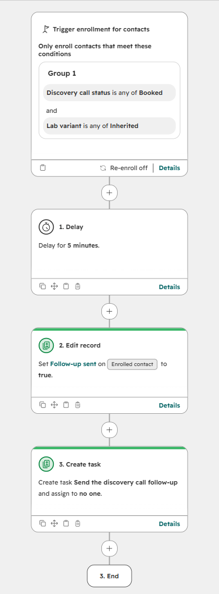
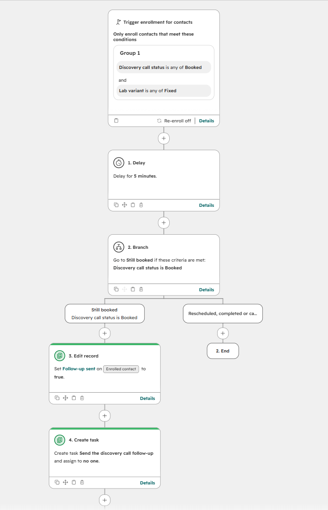

# hubspot-workflow-lab

**Taking over someone else's HubSpot workflows: map them, reproduce the bug, fix it, prove the fix with scripted scenarios.**

[](https://github.com/danilablagorodniy37/hubspot-workflow-lab/actions/workflows/ci.yml)
[](LICENSE)
[](pyproject.toml)

A classic inherited-portal bug: a contact books a discovery call and enters a follow-up workflow. During the delay they reschedule, or the call happens, and they still get the "how was our call?" follow-up. This repository reproduces that bug in a HubSpot developer sandbox, fixes it, and shows the difference with six scripted contacts, so the fix is a measured result rather than a claim.

> Everything here runs in a **HubSpot developer test account** with fictional contacts. It is a reference build that shows how I approach a takeover, not a client's portal.

## What is in the portal

Four contact workflows, as a client might hand them over. The map below is generated from the live portal by `hslab map` ([docs/workflow-map.md](docs/workflow-map.md)), and every workflow is exported as JSON in [workflows/](workflows/).

| Workflow | On | Enrols when | Unenrols when no longer matching | Writes |
|---|---|---|---|---|
| Discovery call follow-up (inherited) | yes | status is Booked | no | `follow_up_sent` |
| No-show nurture (inherited) | yes | status is No show | no | `follow_up_sent` |
| Discovery follow-up (old copy, off) | no | status is Booked | no | `follow_up_sent` |
| Discovery call follow-up (fixed) | yes | status is Booked | **yes** | `follow_up_sent` |

The map also flags the first thing worth knowing in a takeover: **four workflows write the same property**, `follow_up_sent`, one of them a forgotten copy. Change one and the others still fire.

<table>
<tr>
<td valign="top"></td>
<td valign="top"></td>
</tr>
<tr>
<td>Inherited: enrol, wait, follow up. Nothing looks at what happened during the wait.</td>
<td>Fixed: contacts who stop matching "Booked" are unenrolled, and a branch re-checks the status right before the follow-up.</td>
</tr>
</table>

## Why the inherited workflow sends the wrong email

1. **The delay is blind.** "Delay for a set amount of time" does not look at events. Whatever happens to the contact during those days, the next action runs.
2. **Enrolment is checked once.** The contact met "status is Booked" when it enrolled. With "unenrol contacts who no longer meet the criteria" off, a reschedule or a completed call does not take it out.
3. **Nothing re-checks before the action.** The follow-up step trusts the state from enrolment time, not the state now.
4. **Another workflow writes the same flag.** The no-show nurture and an old copy also write `follow_up_sent`, so the property cannot be trusted as a record of what was sent.

The fix closes 2 and 3 in the workflow itself: unenrol when the criteria stop matching, and an if/then branch on the current status right before the follow-up. In a production portal the delay would also become "delay until" the call date, and the shared flag would be split per workflow; both are noted under "What I would do next in a real portal".

## Results

Measured by `hslab scenarios` against the live workflows: six fresh contacts, one per variant and scenario. Each books a call; two minutes later it reschedules, has the call, or does nothing; after nine minutes the script reads back whether the follow-up fired. The workflow delay is 5 minutes, a stand-in for 2 days.

| Variant | Scenario | Follow-up sent | Wanted | Result |
|---|---|---|---|---|
| inherited | rescheduled | yes | no | **wrong** |
| inherited | completed | yes | no | **wrong** |
| inherited | no_action | yes | yes | correct |
| fixed | rescheduled | no | no | correct |
| fixed | completed | no | no | correct |
| fixed | no_action | yes | yes | correct |

**The inherited workflow sent 2 wrong follow-ups out of 3; the fixed one sent 0.** Both sent the one follow-up that was wanted. Full run, with the time and contact ids, in [docs/scenario-results.md](docs/scenario-results.md).

The property history shows the bug the way HubSpot recorded it ([docs/property-history.md](docs/property-history.md), from `hslab history`). For the inherited contact that rescheduled, the status changed to Rescheduled at 18:53:45 UTC, and at 18:56:58 the workflow still set `follow_up_sent` to true. The fixed contact rescheduled at the same second, and nothing changed after it.

## Run it yourself

1. Create a free HubSpot developer account, then a developer test account inside it (Development > Testing > Test accounts). It comes with a 90-day Enterprise trial, which is what makes workflows available.
2. In the test account create a service key (Development > Keys > Service keys) with the scopes listed in `.env.example`, and put it in `.env`. Never commit it: `scripts/check_secrets.py` runs in CI and refuses anything that looks like a HubSpot token.
3. Then:

```bash
python -m venv .venv && . .venv/bin/activate     # Windows: .venv\Scripts\activate
pip install -e ".[dev]"
hslab check            # which portal, which data centre, how many workflows the key can see
hslab setup            # the lab properties, 30 contacts, 10 deals (idempotent)
hslab build            # the workflows (Workflows API v4, beta): created, or updated by name
hslab map              # export every workflow as JSON and write docs/workflow-map.md
hslab scenarios        # the six contacts, about 10 minutes, writes docs/scenario-results.md
pytest                 # no network, no key needed
```

## Notes from building it

- **The Workflows API v4 is in beta and strict about shape.** Hand-written workflow JSON returned HTTP 500 with no detail. Building one workflow in the HubSpot editor, reading it back with `GET /automation/v4/flows/{id}` and copying its exact structure fixed it: the API wants `crmObjectCreationStatus` and a typed `value` (`{"staticValue": "true", "type": "STATIC_VALUE"}`) on set-property actions. `hslab/build.py` now produces that shape.
- **Updates are not always atomic.** A PUT that changed a workflow's actions to a different shape failed with "Invalid request to flow update" but still changed its enrolment. Read the workflow back after every write; the map does that for free.
- **Service keys replace private apps** for single-account API access in new HubSpot accounts; legacy private apps are still offered in test accounts.

## What I would do next in a real portal

- Replace the fixed delay with "delay until" the call date property, so the follow-up lands a set time after the actual call, wherever it moved to.
- Give each workflow its own "sent" property, or log sends to a timeline event, so one workflow cannot overwrite another's record.
- Archive the old copy after checking its enrolment history, and run the map weekly so new overlaps show up before they cause a complaint.
- Put the scenario run in CI against a sandbox, so every workflow change is tested the way this fix was.

## Project layout

```
src/hslab/
  client.py      HubSpot client: bearer auth, retries on 429 and 5xx, paging
  portal.py      properties, contacts and deals for the lab (idempotent)
  build.py       the workflows as Workflows API v4 specs
  flowmap.py     export to JSON, the map, shared-property detection
  scenarios.py   book, act, wait, read back; expected outcomes
workflows/       the exported workflows, as HubSpot returns them
docs/            workflow-map.md, scenario-results.md, canvas screenshots
tests/           no network, no key
```

## Author

Daniel Blago, Python and automation engineer, UK. [GitHub](https://github.com/danilablagorodniy37) · [Upwork](https://www.upwork.com/freelancers/~01cb77ac692f720f4e)

## Licence

MIT. The contacts, the deals and the "inherited" workflows are fictional and live in a HubSpot developer test account.
